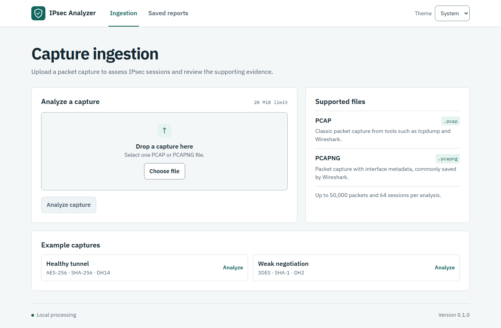
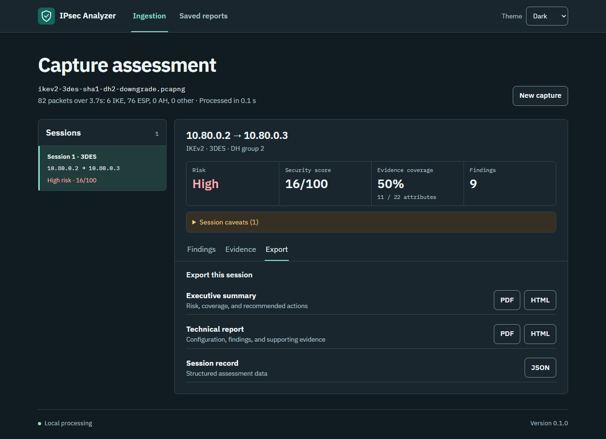
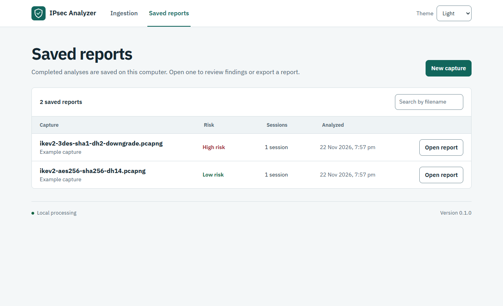

# IPsec Analyzer

IPsec Analyzer reads saved PCAP and PCAPNG files and builds a security
assessment for each IPsec session. The local dashboard shows negotiated
settings, evidence, findings, and coverage. It saves completed analyses and
exports executive and technical reports as PDF or HTML, with a JSON record
for the session data.

**SIH26160** (National Technical Research Organisation) and a B.Tech CSIT
(Cybersecurity) final-year PBL project.
Team: Chaitanya Sawant, Vansh Jangra, Aditya Sonawane. Guide: Dr. Chaya Nayak.

Read [VISION.md](VISION.md) for what is being built and why, and
[PLAN.md](PLAN.md) for how and when.

## The one idea worth knowing

IPsec exposes different parameters in different ways, so every attribute this
tool reports carries the evidence behind it:

| Level | Meaning | Confidence |
|---|---|---|
| **Observed** | Read from a cleartext protocol field by a deterministic parser | Certain, cites the packet |
| **Inferred** | Derived from the metadata of encrypted traffic | An estimate with the supporting features |
| **Assisted** | Read from material the operator supplied | Certain, names the source |
| **Unknown** | Not determinable from the available evidence | Said plainly, and excluded from the score |

> Parse what the protocol shows in cleartext. Infer what it hides.
> Say "unknown" when neither is possible. Never present an inference as an
> observation.

That rule is enforced in code, not by convention: `Attribute` has no public
constructor, and each of its four builders demands the proof its level requires.
See `analyzer/record/attribute.py`.

Unknowns never cost score points. They lower a separate **coverage** figure
reported beside the score, so a capture that revealed little reads as incomplete
rather than as clean.

## Quick start

Follow [Start.md](Start.md) for installation from a fresh checkout, your first
capture analysis, and report exports.

Start the local dashboard with Python 3.11 or newer:

```sh
python -m pip install ".[app]"
ipsec-analyzer web
```

Open <http://127.0.0.1:8000> to try a bundled example or analyze a capture.
See the [dashboard runbook](docs/dashboard.md) for setup, limits, and verification.

## Dashboard

The ingestion screen lists supported formats, shows upload limits, and provides
two bundled captures. Selected files also get a processing-time estimate.



| Session assessment and exports in Dark mode | Saved reports from the bundled captures |
| --- | --- |
|  |  |

The dashboard runs on the loopback interface. HTTPS, encrypted report
storage, and multiple local worker processes are documented in the
[dashboard runbook](docs/dashboard.md).

## Command line

After installing the project, run these commands with the virtual
environment active:

```sh
ipsec-analyzer analyse tests/golden/ikev2-3des-sha1-dh2-downgrade.pcapng --out demo-results/
ipsec-analyzer report demo-results/ikev2-3des-sha1-dh2-downgrade-01.json --kind executive
ipsec-analyzer inspect capture.pcapng
ipsec-analyzer rules
```

See the [operator runbook](docs/operational-mvp.md) for the clean-install demo,
exit codes, and offline report verification.

## Pipeline

```
pcap -> [ingest] -> [session builder] -> [IKE parser]      (Observed)
                                      -> [ESP/AH analyzer] (Observed)
                                      -> [inference]       (Inferred)
                            |
                            v
                   session records (JSON, separate fresh IKEv2 negotiations)
                            |
              [rule engine] -> findings -> [scoring + threat matrix]
                            |
                  [dashboard]   [report generator]
```

The [session record schema](dataset/schemas/session_record.schema.json) is
shared by the analysis engine, report generator, and dashboard.

## Testbed

Two strongSwan gateways with a client behind each, dual-stack, in Docker. Every
run is rendered from one parameter set, captured on the host side of the WAN
bridge, and labelled in a manifest written from the same parameters.

```sh
sh scripts/testbed-bootstrap.sh                          # once per Docker restart
docker build -t ipsec-analyzer/strongswan:5.9 -f testbed/Dockerfile.strongswan testbed

python testbed/run_matrix.py cipher --dry-run   # list runs and estimated time
python testbed/run_matrix.py cipher             # resumable; skips finished runs
python testbed/verify_truth.py                  # check every label three ways
```

Corpora live in `testbed/matrix.yaml`. Each run lands in
`dataset/runs/<run_id>/` (capture, xfrm keys, charon logs, manifest) and adds a
line to `dataset/manifest.jsonl`. `verify_truth.py` checks each label against
charon's negotiated proposals and the kernel's SAs, and decrypts the capture
with the logged keys.

The two-peer compose files (`ikev2-basic.yml`, `ikev2-weak.yml`) made the
golden captures and are kept for regenerating them.

The bootstrap step exists because the WSL2 kernel has `CONFIG_XFRM=y` built in
but ships ESP, AH and PF_KEY as modules that are not loaded at boot. A container
cannot `modprobe` for itself, so one privileged container loads them into the
Docker VM; after that, ordinary containers with `CAP_NET_ADMIN` install xfrm
states normally.

**Known limit:** the WSL2 kernel has no ChaCha20-Poly1305 transform for kernel
IPsec, so that suite is listed as unavailable in `matrix.yaml` and skipped.

## Tests

```sh
python -m pip install ".[app,dev]"
python -m pytest -m "not testbed"
ruff check analyzer/ reports/ tests/ eval/ scripts/smoke_dashboard.py
```

The golden captures in `tests/golden/` are committed deliberately as test
oracles, and their expected values come from what strongSwan reported when each
tunnel came up rather than from analyzer output. So the tests check the analyzer
against reality, not against itself.

The [evaluation plan](docs/EVAL_PLAN.md) and [dataset datasheet](dataset/datasheet.md)
describe the labeled testbed runs. After collecting the corpus, install the
`eval` extra and run `sh eval/reproduce.sh` to regenerate the evaluation
tables and plots.

## Scope

The current release focuses on passive IKEv2 assessment, ESP and AH
observations, configuration inference, and reporting. The security score
summarizes the findings for a session. Coverage shows how much of its
configuration the analyzer could determine.

**Not goals:** decrypting traffic or recovering keys; exploiting anything;
WireGuard, OpenVPN or SSL VPN; probing any system the operator is not authorised
to test.

Standards baseline: NIST SP 800-77 Rev. 1, RFC 8247, RFC 8221, RFC 9395.

## Authorised use only

Captures must come from networks you are permitted to monitor. The active
probing module (phase 7) requires a target allowlist and an explicit
authorisation flag, and logs every probe.
